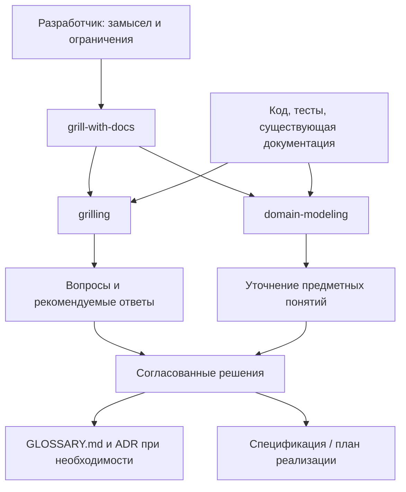
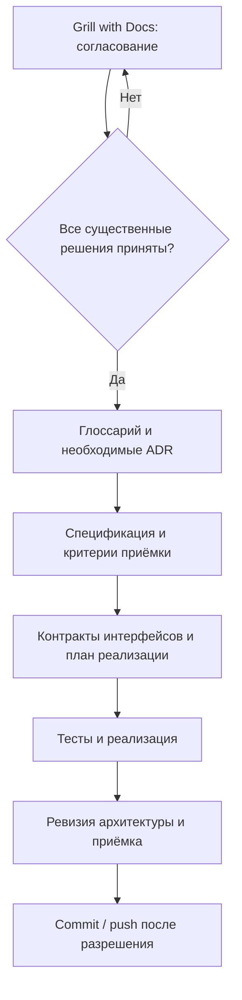

# Grill with Docs: установка и применение

**Практическое руководство для Windows 10/11 и macOS**  
Состояние документации: 25 ноября 2026 г. · Редакция 2: совместная установка с плагином Codex.  
Исходный проект: [mattpocock/skills](https://github.com/mattpocock/skills) · [Карточка на MCP.so](https://mcp.so/skills/grill-with-docs)

> **Главное:** `grill-with-docs` — Agent Skill, а не MCP-сервер. Нужны `grill-with-docs`, `grilling` и `domain-modeling`. Можно установить файлы во все клиенты либо использовать **плагин в Codex и отдельные установки в OpenCode/Antigravity**. Для смешанной схемы выберите собственные каталоги клиентов или отключите файловые дубликаты в Codex по точному пути — см. [§4.5](#45-совместная-установка-в-нескольких-клиентах). Общая `.agents/skills/` обеспечивает переносимость, но не изоляцию от Codex.

## Содержание

1. [Назначение и зависимости](#1-назначение-и-зависимости)
2. [Быстрая установка для всех клиентов](#2-быстрая-установка-для-всех-клиентов)
3. [Где хранятся скиллы](#3-где-хранятся-скиллы)
4. [Codex CLI и расширение IDE](#4-codex-cli-и-расширение-ide)
5. [ChatGPT Desktop и Codex Cloud](#5-chatgpt-desktop-и-codex-cloud)
6. [OpenCode](#6-opencode)
7. [Google Antigravity](#7-google-antigravity)
8. [Ручная установка из Git](#8-ручная-установка-из-git)
9. [Единое хранилище AI Skills](#9-единое-хранилище-ai-skills)
10. [Инициализация проекта и рабочий процесс](#10-инициализация-проекта-и-рабочий-процесс)
11. [Приёмочный тест](#11-приёмочный-тест)
12. [Обновление, удаление и диагностика](#12-обновление-удаление-и-диагностика)
13. [Что выбрать](#13-что-выбрать)
14. [Источники](#14-источники)

**Быстрые переходы:** [выбор схемы](#20-сначала-выберите-схему) · [плагин Codex](#43-альтернатива--официальный-плагин-автора-для-codex) · [отключение дубликатов по пути](#44-отключение-скилла-без-удаления) · [совместная установка](#45-совместная-установка-в-нескольких-клиентах) · [переход с прежней установки](#454-переход-с-уже-выполненной-общей-установки).

## 1. Назначение и зависимости

Grill with Docs — методика согласования проектного решения **до реализации**. Агент исследует репозиторий, задаёт вопросы, предлагает рекомендуемые ответы, проверяет терминологию и помогает записывать решения в документацию. Это интерактивное инженерное интервью, а не автоматическое написание кода по первому запросу.

В актуальном исходном `SKILL.md` основной скилл фактически является диспетчером: он поручает активировать два других скилла. При установке только `grill-with-docs` часть процесса может не сработать.

| Skill | Назначение | Исходная директория в GitHub |
|---|---|---|
| `grill-with-docs` | Организация интервью с документированием | `skills/engineering/grill-with-docs/` |
| `grilling` | Раунды вопросов с рекомендованными ответами; устранение неявных допущений | `skills/productivity/grilling/` |
| `domain-modeling` | Терминология, предметная модель, проверка решений на сценариях, глоссарий и ADR | `skills/engineering/domain-modeling/` |
| `setup-matt-pocock-skills` | Дополнительная настройка инженерного процесса, места хранения документации и задач | Найти через `skills add ... --list` |

Последний скилл полезен при внедрении коллекции целиком, но не является одной из двух непосредственных зависимостей `grill-with-docs`.



### 1.1. Почему не нужно настраивать MCP

Agent Skills — локальные или управляемые пакеты инструкций. Их обязательный компонент — `SKILL.md`; рядом могут находиться примеры, шаблоны, скрипты и дополнительные ресурсы. MCP, напротив, предназначен для предоставления агенту внешних инструментов и данных.

Поэтому для этого скилла не нужно:

- вводить URL страницы MCP.so в настройки MCP;
- добавлять `[mcp_servers.grill-with-docs]` в Codex;
- менять `mcp` в `opencode.json` или настройки MCP в Antigravity;
- открывать сетевой порт, запускать отдельный процесс-сервер или получать API-ключ скилла.

Для установки нужен доступ к репозиторию/пакету, а для работы — обычный доступ к модели в соответствующем клиенте. Внешние инструменты понадобятся только при дополнительных задачах, например чтении закрытого трекера, если клиент не имеет такого доступа сам.

### 1.2. Особенность ручного вызова

В исходнике `grill-with-docs` присутствует `disable-model-invocation: true`, а в его `agents/openai.yaml` задано `allow_implicit_invocation: false`. Это означает, что автор рассчитывает на **явный запуск пользователем**. Разные клиенты могут трактовать дополнительные метаданные неодинаково; далее приведены явные способы запуска, а не надежда на автоподбор.

## 2. Быстрая установка для всех клиентов

### 2.0. Сначала выберите схему

| Схема | Codex | OpenCode и Antigravity | Основной маршрут |
|---|---|---|---|
| Общая файловая установка | Локальные `SKILL.md` | Те же скиллы в поддерживаемых каталогах | §2.2 глобально или §2.3 в проект |
| Плагин Codex + отдельные каталоги | Плагин Matt Pocock | Собственные глобальные каталоги клиентов | **§4.5.2 и §8; рекомендуется для смешанной установки** |
| Плагин Codex + Vercel Skills CLI | Плагин; общие файловые экземпляры отключены по `path` | Файлами управляет `npx skills` | §4.5.3 и §4.4 |

Для каждого скилла в каждом клиенте выбирайте один активный источник. Разные клиенты могут получать один и тот же скилл разными способами. Автор формулирует выбор именно «на агента», а не «на весь компьютер»: [README Matt Pocock](https://github.com/mattpocock/skills#installation-30-second-setup).

Параметр `-a` выбирает цели установщика, но не запрещает другим клиентам обнаруживать записанные файлы. Удаление `-a codex` из команды не обеспечивает изоляцию от Codex; подробности — §4.5.1.

### 2.1. Проверка окружения

Для установки через Vercel Skills CLI требуются Node.js (текущая документация требует не ниже 22.20), npm/npx и доступ к npm Registry и GitHub. Git нужен для альтернативной ручной установки и управления проектами.

Windows PowerShell 5.1 / 7:

```powershell
node --version
npm.cmd --version
npx.cmd --version
git --version
codex --version
opencode --version
```

macOS (zsh/bash):

```bash
node --version
npm --version
npx --version
git --version
codex --version
opencode --version
```

Если какой-либо агент установлен только как GUI, отсутствие его CLI-команды само по себе не мешает установке файлов скилла. Если `npx.ps1` блокируется Execution Policy, используйте `npx.cmd`, а не отключайте политику безопасности PowerShell целиком.

Для проверки синтаксиса установленного менеджера:

```powershell
npx.cmd skills@latest --help
npx.cmd skills@latest add --help
npx.cmd skills@latest add mattpocock/skills --list
```

На macOS замените `npx.cmd` на `npx`. Последняя команда позволяет просмотреть состав пакета без установки.

### 2.2. Глобальная файловая установка для трёх клиентов

Команда ниже относится к **общей файловой схеме без плагина Matt Pocock в Codex**. Для смешанной установки переходите к §4.5.

Выполнить один раз на каждом компьютере и в каждом отдельном пользовательском окружении.

Windows:

```powershell
npx.cmd skills@latest add mattpocock/skills --skill grill-with-docs --skill grilling --skill domain-modeling -a codex -a opencode -a antigravity -g -y
```

macOS:

```bash
npx skills@latest add mattpocock/skills \
  --skill grill-with-docs --skill grilling --skill domain-modeling \
  -a codex -a opencode -a antigravity -g -y
```

Расшифровка параметров:

| Параметр | Смысл |
|---|---|
| `mattpocock/skills` | Репозиторий исходных скиллов |
| `--skill NAME` | Выбрать конкретный скилл, повторяется для каждой зависимости |
| `-a NAME` | Клиент назначения (`codex`, `opencode`, `antigravity`) |
| `-g` | Глобальная область пользователя |
| `-y` | Без интерактивного подтверждения; применять после проверки источника |

Менеджер выбирает пути и режим размещения. Для OpenCode текущая реализация использует общий `~/.agents/skills/`, который также читает Codex. Это не обязательно отдельная копия в собственном каталоге каждого клиента. При одном локальном пользовательском окружении файловые скиллы не нужно повторно устанавливать для Codex CLI и Desktop.

Если нужно сначала выбрать метод размещения (ссылки либо копии), уберите `-y`:

```powershell
npx.cmd skills@latest add mattpocock/skills --skill grill-with-docs --skill grilling --skill domain-modeling -a codex -a opencode -a antigravity -g
```

При проблемах с символическими ссылками на Windows выберите копирование. Режим может выбираться автоматически в зависимости от набора клиентов и версии менеджера. **`--copy` не изолирует установку OpenCode от Codex:** для OpenCode общий путь определяется до выбора режима. См. [реализацию Vercel](https://github.com/vercel-labs/skills/blob/main/src/installer.ts).

### 2.3. Установка только в текущий репозиторий

Использовать вместо глобальной файловой установки, если нужно воспроизводимое состояние проекта или совместная работа команды.

**При активном плагине Codex проектная `.agents/skills/` тоже создаёт пересечение.** Либо используйте в этом окружении только проектные файлы, либо отключите соответствующие файловые экземпляры по абсолютным путям. Исключения для домашнего каталога на проектные пути не распространяются.

Windows:

```powershell
Set-Location 'D:\projects\my-project'
git rev-parse --show-toplevel
npx.cmd skills@latest add mattpocock/skills --skill grill-with-docs --skill grilling --skill domain-modeling -a codex -a opencode -a antigravity -y
```

macOS:

```bash
cd ~/projects/my-project
git rev-parse --show-toplevel
npx skills@latest add mattpocock/skills \
  --skill grill-with-docs --skill grilling --skill domain-modeling \
  -a codex -a opencode -a antigravity -y
```

Здесь **нет `-g`**. По актуальной таблице Vercel все три клиента используют общий проектный каталог `.agents/skills/`. Проверьте фактическое размещение.

```text
my-project/
├── .agents/
│   └── skills/
│       ├── grill-with-docs/
│       │   ├── SKILL.md
│       │   └── agents/openai.yaml
│       ├── grilling/
│       │   └── SKILL.md
│       └── domain-modeling/
│           ├── SKILL.md
│           └── … дополнительные материалы …
├── skills-lock.json        # если создан менеджером
├── AGENTS.md               # если используется в проекте
├── README.md
└── src/
```

Если скиллы должны быть доступны другим разработчикам, CI или облачному агенту, проверьте `git status`, содержимое папок, правила `.gitignore` и типы ссылок. В Git лучше сохранять реальные файлы внутри репозитория, а не ссылки на внешний пользовательский каталог. Сохраняйте также сопутствующие материалы и сведения об исходной лицензии. Lock-файл полезен для воспроизводимости.

**Не выполняйте одновременно §2.2 и §2.3 для одного набора без причины:** проектная копия может дублировать глобальную либо переопределять её в конкретном клиенте.

## 3. Где хранятся скиллы

`~` в таблице — домашний каталог пользователя; в обычной Windows-сессии ему соответствует `$HOME` (часто `%USERPROFILE%`). Для WSL, SSH и облачного агента это другой домашний каталог.

| Клиент | Глобальная папка | Папка в проекте |
|---|---|---|
| Codex CLI / IDE extension / Desktop (локально) | `~/.agents/skills/` | `.agents/skills/` |
| OpenCode | `~/.config/opencode/skills/` | `.opencode/skills/` |
| OpenCode — совместимый вариант | `~/.agents/skills/` | `.agents/skills/` |
| Antigravity IDE / App / CLI | `~/.gemini/config/skills/` | `.agents/skills/` |
| Antigravity IDE — совместимость со старыми версиями | `~/.gemini/antigravity/skills/` | `.agent/skills/` |

Таблица перечисляет **места обнаружения файловых скиллов**, а не обещает, куда установит файлы конкретный менеджер. OpenCode также поддерживает пользовательскую и проектную `.claude/skills`. Antigravity CLI имеет дополнительные совместимые пути; для обычной установки достаточно основной строки.

В смешанной схеме собственные глобальные каталоги OpenCode и Antigravity позволяют отделить их файлы от источников Codex. Установка Vercel для OpenCode, напротив, направляется в общий `~/.agents/skills/` даже при указанном `-a opencode`. Основания: [OpenCode — Discovery](https://opencode.ai/docs/skills/#discovery), [Antigravity — Skills](https://antigravity.google/docs/skills), [классификация агентов Vercel](https://github.com/vercel-labs/skills/blob/main/src/agents.ts), [установщик Vercel](https://github.com/vercel-labs/skills/blob/main/src/installer.ts).

**Плагин и отдельный `SKILL.md` — разные способы подключения.** Поддержка файловых скиллов в Codex IDE extension не означает поддержку плагинов; ограничение расширения приведено в §4.3.

### 3.1. Проверка файлов в Windows

```powershell
$names = @('grill-with-docs', 'grilling', 'domain-modeling')
$roots = @(
    (Join-Path $HOME '.agents\skills'),
    (Join-Path $HOME '.config\opencode\skills'),
    (Join-Path $HOME '.gemini\config\skills'),
    (Join-Path $HOME '.gemini\antigravity\skills')
)

foreach ($root in $roots) {
    foreach ($name in $names) {
        $path = Join-Path $root "$name\SKILL.md"
        [PSCustomObject]@{
            Root = $root
            Skill = $name
            Present = (Test-Path -LiteralPath $path -PathType Leaf)
        }
    }
}
```

Не требуется, чтобы все строки были `True`. При файловой схеме OpenCode может читать общий каталог, а при плагине Codex его собственный набор вообще находится за пределами этой проверки. `Test-Path` подтверждает наличие файлов, но не их активность. В каждом клиенте проверьте фактически выбранный источник всех трёх скиллов по §11.

### 3.2. Проверка в macOS

```bash
for root in "$HOME/.agents/skills" "$HOME/.config/opencode/skills" "$HOME/.gemini/config/skills"; do
  for skill in grill-with-docs grilling domain-modeling; do
    if [ -f "$root/$skill/SKILL.md" ]; then
      printf 'OK      %s\n' "$root/$skill"
    else
      printf 'ABSENT  %s\n' "$root/$skill"
    fi
  done
done
```

Для проектной установки:

```bash
ls -la .agents/skills
```

Windows-эквивалент:

```powershell
Get-ChildItem -Force .agents\skills
```

## 4. Codex CLI и расширение IDE

### 4.1. Отдельная установка только в Codex

Этот этап предназначен для файловой установки. Если уже выполнена общая установка из §2 или выбран плагин Codex из §4.3, команду ниже пропустите.

```powershell
npx.cmd skills@latest add mattpocock/skills --skill grill-with-docs --skill grilling --skill domain-modeling -a codex -g -y
```

На macOS — та же команда с `npx`.

Проверка:

```powershell
npx.cmd skills@latest list -g -a codex
Get-Content (Join-Path $HOME '.agents\skills\grill-with-docs\SKILL.md')
```

### 4.2. Вызов

Откройте корень проекта, запустите `codex` (или панель Codex в VS Code/другой поддерживаемой IDE). В CLI можно открыть `/skills` либо выбрать скилл, начав ввод с `$`.

Запрос внутри Codex:

```text
$grill-with-docs

Проведи архитектурное интервью по изменению текущего проекта.
Сначала изучи AGENTS.md, README, существующую документацию и релевантный код.
Работай на русском языке. Пока не реализуй изменения.
```

Если основная инструкция не активирует зависимости через доступный клиенту механизм, явно выберите все три скилла или напишите:

```text
$grill-with-docs $grilling $domain-modeling
Используй все три скилла совместно. Сначала загрузи их инструкции и требуемые ресурсы.
```

При использовании в IDE выберите скиллы через механизм упоминаний, если он доступен. Не путайте `/skills` в интерактивном Codex с аргументом внешней команды `codex`.

### 4.3. Альтернатива — официальный плагин автора для Codex

Этот вариант удобен, если нужны все скиллы Matt Pocock и обновление средствами плагина. **Его можно сочетать с установками для OpenCode и Antigravity.** Требуется исключить повторную загрузку того же набора файлов самим Codex.

```powershell
codex plugin marketplace add mattpocock/skills
codex plugin add mattpocock-skills@mattpocock
```

Это опубликованные автором команды. В README также указано обновление при запуске. Если установленная версия CLI их не знает, проверьте `codex plugin --help` и используйте поддерживаемый этой версией маршрут либо файловую установку. Источник: [README Matt Pocock](https://github.com/mattpocock/skills).

Плагин устанавливает коллекцию для Codex. OpenCode и Antigravity получают собственные установки по §4.5. При полном пакете пересечение может включать больше трёх скиллов; учитывайте также `setup-matt-pocock-skills` и другие установленные файловым способом элементы коллекции.

**Поддерживаемая поверхность:** эта схема рассчитана на Codex CLI и Codex в ChatGPT Desktop. На дату проверки официальная документация указывает, что **Codex IDE extension не поддерживает плагины**. Для расширения используются отдельные файловые скиллы. Не отключайте их в общей конфигурации с расчётом, что расширение подхватит плагин: если нужен один набор сразу в CLI, Desktop и IDE extension, проще выбрать общую файловую схему §2. Источник: [OpenAI — Plugins, supported surfaces](https://learn.chatgpt.com/docs/plugins).

После установки откройте новую сессию и проверьте доступность скиллов плагина. `$setup-matt-pocock-skills` запускается один раз для репозитория, который должен использовать процесс автора; порядок настройки — §10.

### 4.4. Отключение скилла без удаления

Для устранения файлового дубликата при сохранении плагина используйте **абсолютный `path` конкретного `SKILL.md`** в пользовательском `~/.codex/config.toml`. Если задан собственный `CODEX_HOME`, используйте конфигурацию соответствующего окружения.

Пример одного правила; `C:/Users/USER` нужно заменить на фактический домашний каталог:

```toml
[[skills.config]]
path = "C:/Users/USER/.agents/skills/grill-with-docs/SKILL.md"
enabled = false
```

В PowerShell следующий фрагмент выводит готовые блоки для всех трёх реально найденных пользовательских файлов. Добавьте полученный текст в существующий `config.toml`, сохранив его остальные настройки:

```powershell
$names = @('grill-with-docs', 'grilling', 'domain-modeling')
$skillRoot = Join-Path $HOME '.agents\skills'

foreach ($name in $names) {
    $skillFile = Join-Path $skillRoot "$name\SKILL.md"
    if (-not (Test-Path -LiteralPath $skillFile -PathType Leaf)) {
        Write-Warning "File not found; inspect the actual skill source: $skillFile"
        continue
    }
    $tomlPath = (Get-Item -LiteralPath $skillFile).FullName.Replace('\', '/')
    @"
[[skills.config]]
path = "$tomlPath"
enabled = false

"@
}
```

В macOS правила имеют тот же вид с абсолютными путями `/Users/USER/.agents/skills/<name>/SKILL.md`. Примените их к `grill-with-docs`, `grilling` и `domain-modeling`. Путь должен соответствовать именно отключаемому экземпляру, а не файлу внутри плагина.

Ограничения селекторов:

- `path` отключает один конкретный файловый экземпляр.
- `name` совпадает со всеми скиллами с этим именем и может отключить нужный экземпляр из плагина.
- Для каждого правила укажите один селектор. Если несколько правил совпадают, действует последнее совпадающее правило.
- Исключение для `~/.agents/skills/...` не отключает копии в `<repo>/.agents/skills/...`. Проектные пути учитываются отдельно.
- При добавлении других скиллов коллекции добавьте правила для новых пересекающихся файлов.

Для полного отключения всех экземпляров, когда это и есть цель, допустим отдельный вариант:

```toml
[[skills.config]]
name = "grill-with-docs"
enabled = false
```

**Этот пример с `name` не применяется для сохранения плагинового скилла.** При смешанной установке проверьте и существующие правила по имени, чтобы они не выключали плагин. После изменений начните новую CLI-сессию; если интерфейс сохранил старый список, обновите страницу Skills и проверьте реально загружаемые пути.

Основания: [OpenAI — Build skills](https://learn.chatgpt.com/docs/build-skills#enable-or-disable-local-codex-skills) и [Configuration Reference](https://learn.chatgpt.com/docs/config-file/config-reference).

### 4.5. Совместная установка в нескольких клиентах

#### 4.5.1. Почему исключить `-a codex` недостаточно

В текущем исходном коде Vercel OpenCode относится к клиентам, которые читают общий `~/.agents/skills/`. Функция `getAgentBaseDir` возвращает этот путь до выбора режима установки. Поэтому:

- `-a opencode -g` записывает скиллы в общий каталог, видимый Codex;
- добавление `--copy` для OpenCode сохраняет тот же общий путь;
- совместная команда `-a opencode -a antigravity -g` не гарантирует изоляцию от Codex;
- проектная `.agents/skills/` также доступна Codex.

Это вывод из [классификации агентов](https://github.com/vercel-labs/skills/blob/main/src/agents.ts) и [реализации установщика](https://github.com/vercel-labs/skills/blob/main/src/installer.ts), а не результат запуска на вашем компьютере. Режим по умолчанию зависит от версии и набора целей; не следует считать, что менеджер всегда создаёт симлинки.

Codex не объединяет одноимённые скиллы автоматически, поэтому плагиновая и файловая версии могут одновременно появляться в выборе. Источник: [OpenAI — Where Codex loads local skills](https://learn.chatgpt.com/docs/build-skills#where-to-save-skills).

#### 4.5.2. Вариант A — собственные каталоги клиентов

Рекомендуется для новой смешанной установки.

| Клиент | Активный источник набора Matt Pocock | Обновление |
|---|---|---|
| Codex CLI / Desktop | Плагин из §4.3 | Механизм плагина |
| OpenCode | `~/.config/opencode/skills/<name>/` | Перенос проверенной версии из своего checkout |
| Antigravity IDE / App / CLI | `~/.gemini/config/skills/<name>/` | Перенос проверенной версии из своего checkout |

Порядок:

1. Установите плагин Codex командами §4.3.
2. Выполните ручной сценарий §8 с `mixed`: он копирует полные каталоги трёх скиллов в собственные глобальные папки OpenCode и Antigravity.
3. Проверьте прежние пользовательские и проектные `.agents/skills/`. Одноимённые файловые экземпляры, видимые Codex, должны отсутствовать либо быть адресно отключены по §4.4.
4. Проверьте загрузку каждого клиента по §11.

Остальные скиллы в общей `.agents/skills/` сохраняются. Для этой схемы не используйте обычный `npx skills add -a opencode` как замену ручному копированию: он возвращает установку OpenCode в общий каталог. Свой checkout или библиотека AI Skills может быть источником копий/ссылок; внутренний кэш плагина Codex не используйте как хранилище для других клиентов.

Если в OpenCode задан иной каталог конфигурации, скорректируйте его целевой путь в §8 и подтвердите фактическое обнаружение. Нативные пути описаны в [OpenCode Skills](https://opencode.ai/docs/skills/) и [Antigravity Skills](https://antigravity.google/docs/skills).

#### 4.5.3. Вариант B — Vercel для остальных клиентов и исключения в Codex

Подходит, если хотите сохранить управление файловой установкой через Vercel Skills CLI.

1. Установите плагин Codex по §4.3.
2. Установите набор для остальных клиентов следующей командой; если он уже установлен, сначала проверьте существующие файлы.
3. По §4.4 отключите в Codex три общих файловых экземпляра по абсолютным путям.
4. Проверьте дополнительные копии в проекте и новые пересечения после обновлений.

Windows:

```powershell
npx.cmd skills@latest add mattpocock/skills --skill grill-with-docs --skill grilling --skill domain-modeling -a opencode -a antigravity -g -y
```

macOS:

```bash
npx skills@latest add mattpocock/skills \
  --skill grill-with-docs --skill grilling --skill domain-modeling \
  -a opencode -a antigravity -g -y
```

Файлы остаются доступны OpenCode и соответствующей установке Antigravity. Исключения `[[skills.config]]` относятся к Codex и выбирают именно файловые пути, сохраняя плагин. Для полной коллекции или дополнительного setup-скилла нужно учесть все совпадения, а не только минимальную тройку.

#### 4.5.4. Переход с уже выполненной общей установки

Если ранее выполняли команду из §2.2, выберите один маршрут перехода:

| Цель | Действие |
|---|---|
| Сохранить Vercel для OpenCode/Antigravity | Оставить файлы, установить плагин Codex и отключить файловые дубликаты по §4.4 |
| Перейти на собственные каталоги клиентов | Сначала разместить и проверить самостоятельные копии по §8, затем устранить прежние пересечения |
| Использовать один набор в Codex CLI, Desktop и IDE extension | Сохранить файловую схему; не рассчитывать на плагин в IDE extension |

Перед переносом или удалением общей копии выясните, не являются ли каталоги других клиентов ссылками на неё. Пример для Windows:

```powershell
Get-Item -LiteralPath (Join-Path $HOME '.gemini\config\skills\grill-with-docs') -Force |
    Select-Object FullName, LinkType, Target
```

Для macOS:

```bash
ls -ld "$HOME/.gemini/config/skills/grill-with-docs"
readlink "$HOME/.gemini/config/skills/grill-with-docs"
```

Повторите проверку для остальных скиллов и фактических каталогов OpenCode. Для обычной папки `readlink` может ничего не вывести и завершиться ненулевым кодом. Пока другой клиент ссылается на общие файлы, их удаление нарушит его установку; адресное отключение в Codex позволяет сохранить эти файлы.

Не считайте `skills remove -a codex` способом запретить обнаружение общего каталога: управление установкой и правила сканирования клиента — разные механизмы. Для сохранения файлов другими клиентами используйте исключения Codex, а не удаление общей папки. Если несколько копий уже существуют, проверьте их содержимое и источник, прежде чем выбирать активную.

#### 4.5.5. Обновления и совпадение версий

Плагин и файловые установки обновляются независимо. Обновление плагина не переносит изменения в OpenCode/Antigravity; ручные копии обновляются из своего checkout, установки Vercel — менеджером. Порядок обслуживания приведён в §12.

Разные версии в разных клиентах сами по себе не означают конфликт установки, но могут давать разный ход интервью. Если нужно сопоставимое поведение, зафиксируйте версию исходников для файловых копий и сверяйте фактическое содержимое с используемым плагином. После изменения состава набора повторяйте проверку путей и пересечений.

## 5. ChatGPT Desktop и Codex Cloud

### 5.1. Codex в ChatGPT Desktop — локальная работа

1. Установите скиллы на той машине, на которой будет выполняться локальная задача, как в §2 или §4.
2. Откройте ChatGPT Desktop, в переключателе продукта выберите **Codex**.
3. Откройте существующий локальный репозиторий либо выберите каталог проекта.
4. Выберите выполнение на этом компьютере (`This computer` / `Local`), либо локальный `Worktree`.
5. Откройте раздел Skills, если он доступен в вашей версии приложения. Официальная документация также указывает deep link `codex://skills`.
6. Выберите `Grill with Docs` (в интерфейсе может использоваться это отображаемое имя) или введите `$grill-with-docs` в поле запроса и выберите соответствующее упоминание, если оно предложено.
7. Отправьте задачу и убедитесь, что агент действительно читает обе зависимости. При необходимости добавьте их явным текстом.

После установки плагина начните новый чат, а при устаревшем списке обновите страницу Skills. Файловые скиллы CLI и Desktop обычно доступны из одного локального пользовательского окружения; для другого пользователя или удалённого хоста проверяйте фактические пути. При плагиновой схеме проверьте, что в Desktop выбран экземпляр из плагина и не активированы его файловые дубликаты.

### 5.2. Codex Cloud, Git worktree, SSH, WSL

| Режим | Где должны находиться файлы |
|---|---|
| Local | Домашний каталог пользователя или текущий репозиторий |
| Local Worktree | Локальная глобальная папка либо файлы, присутствующие в новом worktree |
| Cloud | В репозитории/облачном окружении, доступном задаче |
| SSH / WSL | В домашнем каталоге или репозитории соответствующей удалённой/Linux-среды |

Для переносимости облачного проекта используйте проектную `.agents/skills/` с реальными файлами, сохранёнными в Git. Локальные незакоммиченные файлы или ссылки на `D:\...` не следует считать доступными в облаке.

Если тот же репозиторий открывается локальным Codex с плагином, проектные файлы могут его дублировать. Выберите активный источник для каждого окружения отдельно. Абсолютные исключения с Windows-путями не переносятся автоматически в Cloud, WSL или новый worktree; там пути нужно проверять заново.

### 5.3. Обычный ChatGPT и ChatGPT Work

Установка локальных Codex-скиллов не означает установку в обычный ChatGPT. Не смешивайте локальные каталоги Codex и управляемые Skills в ChatGPT.

Если конкретный аккаунт и рабочее пространство имеют право создавать/загружать Skills, откройте **Plugins → Skills → Create → Upload from your computer** и импортируйте пакет поддерживаемым способом. Для такого импорта подготавливайте полноценные каталоги с инструкциями и ресурсами, а не ссылку на MCP.so. В интерфейсах ChatGPT, поддерживающих Skills, явный выбор производится через `@` и список доступных скиллов.

Доступность этой функции зависит от продукта, плана и административных настроек; Help Center отдельно описывает доступ для соответствующих рабочих пространств Business, Enterprise, Healthcare и Edu. Наличие ChatGPT Pro, режима Work или Desktop само по себе не доказывает, что доступен именно импорт произвольных Skills. Кроме того, импорт одного оркестратора не гарантирует вложенное выполнение двух других скиллов: если доступен импорт, проверяйте все зависимости отдельно. Для работы с исходным кодом проще выбрать Codex.

## 6. OpenCode

### 6.1. Установка

При общей файловой установке §2 повторная установка не нужна. Актуальный OpenCode читает `~/.agents/skills/` непосредственно; дублировать эти же файлы в `~/.config/opencode/skills/` без причины не требуется.

Для установки через Vercel:

```powershell
npx.cmd skills@latest add mattpocock/skills --skill grill-with-docs --skill grilling --skill domain-modeling -a opencode -g -y
```

**Эта команда не изолирует файлы от Codex:** текущий установщик использует общий `~/.agents/skills/` и для OpenCode. Если Codex получает коллекцию через плагин, выберите собственную папку OpenCode с ручным копированием (§4.5.2, §8) либо отключите общий файловый экземпляр только в Codex (§4.5.3).

Проверка установки, управляемой Vercel:

```powershell
npx.cmd skills@latest list -g -a opencode
opencode --version
```

При ручной установке проверяйте `~/.config/opencode/skills/<name>/SKILL.md` и фактический источник в OpenCode; список менеджера не заменяет эту проверку. На macOS команды используют `npx` вместо `npx.cmd`.

Запуск из репозитория:

```powershell
Set-Location 'D:\projects\my-project'
opencode
```

OpenCode Desktop: откройте этот же репозиторий и новую сессию. Убедитесь, что Desktop использует тот же пользовательский профиль и backend, что CLI.

### 6.2. Явный вызов и зависимости

Текущая официальная документация OpenCode описывает упоминание `@skill-id` и инструмент `skill`. Поэтому основной запрос:

```text
@grill-with-docs
Проведи архитектурное интервью по проекту. Работай на русском языке.
Загрузи и используй также grilling и domain-modeling.
```

Если команда `@` не предлагает скилл в установленной версии, не полагайтесь на универсальность слеш-команд. Дайте агенту явную инструкцию:

```text
Используй инструмент skill для загрузки grill-with-docs, grilling и domain-modeling.
Если в этой версии нет такого механизма, прочитай SKILL.md всех трёх скиллов
из фактически выбранного каталога: например, ~/.config/opencode/skills
при раздельной установке либо .agents/skills при общей файловой схеме.
Для каждого скилла укажи прочитанный путь.
Следуй их инструкциям и прочитай связанные шаблоны при необходимости.
```

Затем проверьте, что агент не просто знает название, а загрузил инструкции. В актуальном OpenCode инструмент может отображать ID и факт загрузки в журнале действий. Форматы интерфейса у старых и новых выпусков отличаются.

### 6.3. Разрешения в OpenCode

В обычной ситуации ничего менять не требуется. Если агент не видит скиллы, проверьте права `skill` и конфликты настроек. Ниже **два альтернативных формата**, не вставляйте их вместе.

**Для актуального формата OpenCode V2**, в документации которого используется массив `permissions` (`opencode.jsonc`):

```jsonc
{
  "permissions": [
    { "action": "skill", "resource": "grill-with-docs", "effect": "allow" },
    { "action": "skill", "resource": "grilling", "effect": "allow" },
    { "action": "skill", "resource": "domain-modeling", "effect": "allow" }
  ]
}
```

**Для выпусков с прежней схемой `permission.skill`**, если ваша версия документирует именно её:

```json
{
  "permission": {
    "skill": {
      "grill-with-docs": "allow",
      "grilling": "allow",
      "domain-modeling": "allow"
    }
  }
}
```

Добавляйте только нужные поля в существующий конфиг, не перезаписывайте его целиком. Не выдавайте `allow` всем инструментам для исправления одной проблемы. Разрешение загрузить инструкции не является разрешением исполнять произвольный код или изменять весь компьютер.

### 6.4. Конфликты обнаружения

OpenCode умеет искать скиллы в нескольких источниках. В V2 более специфичный источник, например `.opencode/skills` проекта, может заместить одноимённый глобальный скилл. Если работает неожиданная версия, проверьте фактический ID и путь в журнале агента, наличие `description`, права на загрузку и отсутствие дубликатов.

Даже если OpenCode выбрал собственную копию по приоритету, оставшийся `~/.agents/skills/` всё ещё может обнаружить Codex. Правила выбора OpenCode не являются правилами отключения Codex. Источник: [OpenCode — Skills](https://opencode.ai/docs/skills/).

## 7. Google Antigravity

### 7.1. Установка в Antigravity IDE / App

Если выбранная файловая установка уже выполнена и файлы обнаруживаются, не повторяйте её. Для смешанной схемы с плагином Codex рекомендуемый маршрут — ручное размещение в `~/.gemini/config/skills/` вместе с OpenCode по §8.

Для установки через Vercel непосредственно в глобальный каталог Antigravity можно явно выбрать копирование:

```powershell
npx.cmd skills@latest add mattpocock/skills --skill grill-with-docs --skill grilling --skill domain-modeling -a antigravity -g --copy -y
```

macOS:

```bash
npx skills@latest add mattpocock/skills \
  --skill grill-with-docs --skill grilling --skill domain-modeling \
  -a antigravity -g --copy -y
```

В проверенной реализации отдельный глобальный `--copy -a antigravity` пишет в собственную `~/.gemini/config/skills/`. Это **не относится к OpenCode**: добавление `-a opencode` в ту же команду снова задействует общий каталог. Флаг также не удаляет ранее созданные общие копии; проверьте их по §3 и §4.5. Основание: [Vercel agents.ts](https://github.com/vercel-labs/skills/blob/main/src/agents.ts) и [installer.ts](https://github.com/vercel-labs/skills/blob/main/src/installer.ts).

Для Antigravity CLI Vercel документирует также ID `antigravity-cli`. Актуальные IDE, App и CLI используют глобальную `~/.gemini/config/skills/`; второй экземпляр не нужен, если файлы уже обнаруживаются.

Проверка PowerShell:

```powershell
$root = Join-Path $HOME '.gemini\config\skills'
Get-ChildItem -LiteralPath $root -Force
Get-Content (Join-Path $root 'grill-with-docs\SKILL.md')
```

После обновления через менеджер повторно проверяйте пути (§12); не делайте вывод о сохранении изоляции только по наличию `--copy` в старой команде.

### 7.2. Antigravity IDE: подключение к workspace

1. Откройте корневой каталог репозитория в Antigravity IDE (не одиночный исходный файл).
2. Откройте боковую панель агента.
3. Найдите меню **Customizations** и просмотрите активные Skills. Название/расположение элементов может отличаться в конкретном выпуске IDE.
4. Убедитесь, что доступны `grill-with-docs`, `grilling`, `domain-modeling`.
5. Начните новую сессию, если установили скиллы при работающей IDE.

Для IDE самый надёжный явный запрос — назвать все три скилла и потребовать загрузку их инструкций:

```text
Примени скилл grill-with-docs, используя также grilling и domain-modeling.
Перед началом загрузи инструкции всех трёх скиллов и нужные ресурсы.
Проведи архитектурное интервью на русском языке по открытому репозиторию.
Пока не приступай к реализации.
```

Если в списке команд вашей версии IDE присутствует `/grill-with-docs`, его можно использовать. Однако официальная документация явно описывает слеш-вызов для Antigravity App и CLI; для IDE не следует считать наличие отдельной слеш-команды обязательным.

### 7.3. Antigravity App и CLI

В Antigravity App и актуальном Antigravity CLI используйте:

```text
/grill-with-docs
Проведи архитектурное интервью. Загрузи также grilling и domain-modeling.
```

В CLI после добавления файлов можно выполнить `/skills reload` или создать новую сессию. Если механизм вложенной загрузки скиллов отличается от исходного `Skill tool`, попросите явно прочитать инструкции двух зависимостей и продолжать только после этого.

### 7.4. Старые версии Antigravity IDE

Ранние выпуски использовали проектный путь `.agent/skills/` и пользовательский `~/.gemini/antigravity/skills/`. Современная IDE сохраняет совместимость с ними. Не создавайте дубликаты без необходимости.

Если конкретная старая версия не видит новые глобальные каталоги, проверьте актуальность приложения и при необходимости используйте ручное размещение в единственном поддерживаемом старом пути. Проектная `.agents/skills/` подходит для общей файловой схемы; при активном плагине Codex учитывайте пересечение (§4.5).

### 7.5. Скиллы не влияют на доступность моделей

Скилл не решает проблемы авторизации в Google, VPN, доступности Gemini/Claude, квоты или соединения с backend. Если Antigravity не может отправлять обычные запросы, сначала восстановите работу клиента и выбранной модели. Для чтения уже установленных `SKILL.md` дополнительный MCP не нужен.

## 8. Ручная установка из Git

Этот способ пригоден без Node.js, при недоступности npm, для фиксации версии и для смешанной схемы без общего каталога. Сохраняйте **целые каталоги** скиллов с ресурсами.

Сценарии ниже предлагают три значения `mixed`, `global-shared` и `project`:

| Значение | Назначение файлов | Когда выбирать |
|---|---|---|
| `mixed` | Собственные глобальные каталоги OpenCode и Antigravity | **Плагин Codex + отдельные установки; значение по умолчанию** |
| `global-shared` | Общая `~/.agents/skills/` и собственная папка Antigravity | Файловая установка во все три клиента |
| `project` | `.agents/skills/` текущего проекта | Версионируемая файловая установка в репозиторий |

При `mixed` плагин Codex устанавливается отдельно по §4.3. Скрипты не устраняют уже существующие общие экземпляры; переход с них описан в §4.5.4.

**Проверьте и сами целевые каталоги, и ссылки в их родительских путях.** Если `~/.config/opencode/skills/` или `~/.gemini/config/skills/` уже является симлинком/junction на общую `.agents/skills/`, запись через собственное имя каталога не обеспечивает изоляцию. Для `mixed` используйте реальные отдельные назначения либо отключите получившиеся общие экземпляры в Codex по §4.4. Проверка существования дочерних папок в скриптах ниже эту переадресацию не выявляет.

### 8.1. Windows PowerShell — копирование с выбором схемы

Перед запуском выберите `$layout`. Для `project` откройте корень нужного репозитория. Скрипт сначала проверяет все источники и целевые пути и отказывается перезаписывать существующие каталоги.

```powershell
$ErrorActionPreference = 'Stop'
$layout = 'mixed'  # mixed | global-shared | project
$repo = Join-Path $HOME 'src\mattpocock-skills'

$targets = switch ($layout) {
    'mixed' {
        Join-Path $HOME '.config\opencode\skills'
        Join-Path $HOME '.gemini\config\skills'
    }
    'global-shared' {
        Join-Path $HOME '.agents\skills'
        Join-Path $HOME '.gemini\config\skills'
    }
    'project' {
        Join-Path (Get-Location).Path '.agents\skills'
    }
    default { throw "Unknown layout: $layout" }
}
$targets = @($targets)

if (-not (Test-Path -LiteralPath $repo)) {
    New-Item -ItemType Directory -Force -Path (Split-Path $repo) | Out-Null
    git clone https://github.com/mattpocock/skills.git $repo
    if ($LASTEXITCODE -ne 0) { throw 'git clone failed' }
}

# При необходимости выберите проверенный commit перед копированием.
git -C $repo rev-parse HEAD
if ($LASTEXITCODE -ne 0) { throw 'Invalid source checkout' }

$paths = [ordered]@{
    'grill-with-docs' = 'skills\engineering\grill-with-docs'
    'grilling' = 'skills\productivity\grilling'
    'domain-modeling' = 'skills\engineering\domain-modeling'
}

foreach ($name in $paths.Keys) {
    $src = Join-Path $repo $paths[$name]
    if (-not (Test-Path -LiteralPath (Join-Path $src 'SKILL.md') -PathType Leaf)) {
        throw "Source skill missing: $src"
    }
    foreach ($dest in $targets) {
        $target = Join-Path $dest $name
        if (Get-Item -LiteralPath $target -Force -ErrorAction SilentlyContinue) {
            throw "Target already exists: $target. Inspect it before replacing."
        }
    }
}

foreach ($dest in $targets) {
    New-Item -ItemType Directory -Force -Path $dest | Out-Null
    foreach ($name in $paths.Keys) {
        $src = Join-Path $repo $paths[$name]
        $target = Join-Path $dest $name
        Copy-Item -LiteralPath $src -Destination $target -Recurse
        if (-not (Test-Path -LiteralPath (Join-Path $target 'SKILL.md') -PathType Leaf)) {
            throw "Copy verification failed: $target"
        }
    }
    Get-ChildItem -LiteralPath $dest -Force
}
```

Для нестандартного каталога конфигурации OpenCode замените его путь в ветви `mixed`. Для старой Antigravity IDE аналогично выберите единственный поддерживаемый путь (§7.4).

### 8.2. macOS — аналогичный вариант

Выполнить в bash или zsh. Выберите `layout`; для `project` сначала откройте корень репозитория.

```bash
(
  set -e
  layout='mixed'  # mixed | global-shared | project
  repo="$HOME/src/mattpocock-skills"

  case "$layout" in
    mixed)
      targets=("$HOME/.config/opencode/skills" "$HOME/.gemini/config/skills")
      ;;
    global-shared)
      targets=("$HOME/.agents/skills" "$HOME/.gemini/config/skills")
      ;;
    project)
      targets=("$PWD/.agents/skills")
      ;;
    *)
      printf 'Unknown layout: %s\n' "$layout" >&2
      exit 1
      ;;
  esac

  mkdir -p "$HOME/src"
  if [ ! -d "$repo/.git" ]; then
    git clone https://github.com/mattpocock/skills.git "$repo"
  fi

  # При необходимости выберите проверенный commit перед копированием.
  git -C "$repo" rev-parse HEAD

  skill_paths=(
    skills/engineering/grill-with-docs
    skills/productivity/grilling
    skills/engineering/domain-modeling
  )

  for rel in "${skill_paths[@]}"; do
    name="${rel##*/}"
    test -f "$repo/$rel/SKILL.md"
    for dest in "${targets[@]}"; do
      if [ -e "$dest/$name" ] || [ -L "$dest/$name" ]; then
        printf 'Target exists: %s\n' "$dest/$name" >&2
        exit 1
      fi
    done
  done

  for dest in "${targets[@]}"; do
    mkdir -p "$dest"
    for rel in "${skill_paths[@]}"; do
      name="${rel##*/}"
      cp -R "$repo/$rel" "$dest/$name"
      test -f "$dest/$name/SKILL.md"
    done
    ls -la "$dest"
  done
)
```

Скрипты показывают SHA используемого checkout, но не выполняют автоматический `pull` в ранее существующей копии. Перед обновлением выберите и проверьте нужную ревизию (§12.3).

При переносе исходников сохраняйте уведомления об авторстве и применимую лицензию. Запишите источник и SHA в свой учёт внешних скиллов. Ручная установка не создаёт запись Vercel: обновляйте её переносом из checkout, а не одновременно через менеджер. После копирования выполните проверку §11.

## 9. Единое хранилище AI Skills

Для собственной библиотеки, в которой уже хранятся научные, LaTeX и инженерные скиллы, есть два разумных варианта.

### Вариант A — менеджер `skills` управляет внешними скиллами

Для общей файловой схемы используется §2.2; при плагине Codex — вариант §4.5.3 с адресным отключением пересекающихся файлов. Собственные скиллы разместите отдельно, с уникальными именами. Обновление управляемого внешнего пакета может затронуть локальные правки, поэтому сохраняйте их отдельно.

### Вариант B — свой Git-репозиторий или OneDrive с контролируемой версией

Хранить проверенные каталоги скиллов в библиотеке, например:

```text
AI_skills/
├── engineering/
│   ├── grill-with-docs/
│   ├── grilling/
│   ├── domain-modeling/
│   └── ...
├── science/
├── latex/
└── external-skills.md   # источник, SHA, лицензия, дата проверки
```

На каждой машине подключать необходимые папки с помощью ссылок или явной синхронизации копий. Не требуется размещать всю коллекцию в каждом проекте.

Для смешанной схемы используйте следующее соответствие:

| Источник | Подключение | Получатель |
|---|---|---|
| Проверенные каталоги своей AI Skills | `~/.config/opencode/skills/` | OpenCode |
| Те же проверенные каталоги | `~/.gemini/config/skills/` | Antigravity |
| Пакет Matt Pocock | Установка плагина средствами Codex | Codex CLI / Desktop |

Источником ссылок служит собственное хранилище, а не внутренний каталог кэша плагина Codex. Для общей файловой схемы первый путь заменяется на `~/.agents/skills/`, который читают Codex и OpenCode.

#### Windows: junction для трёх внешних скиллов

Ниже выбрана смешанная схема: плагин Codex + собственные каталоги OpenCode/Antigravity. Проверенные каталоги уже должны находиться в вашей библиотеке в `engineering/`. Путь замените на реальный; для OneDrive обеспечьте локальную доступность файлов.

Проверьте существующие установки перед созданием ссылок. Скрипт пропускает занятые пути и не удаляет прежние экземпляры из общей `.agents/skills/`; их обработка — §4.5.4.

```powershell
$library = 'D:\Users\Ilya\OneDrive\AI_skills\engineering'
$names = @('grill-with-docs', 'grilling', 'domain-modeling')
$roots = @(
    (Join-Path $HOME '.config\opencode\skills'),
    (Join-Path $HOME '.gemini\config\skills')
)

foreach ($root in $roots) {
    New-Item -ItemType Directory -Force -Path $root | Out-Null
    foreach ($name in $names) {
        $target = Join-Path $library $name
        $link = Join-Path $root $name
        if (-not (Test-Path -LiteralPath (Join-Path $target 'SKILL.md'))) {
            throw "Missing source: $target"
        }
        if (Test-Path -LiteralPath $link) {
            Write-Warning "Exists; skipped: $link"
            continue
        }
        New-Item -ItemType Junction -Path $link -Target $target | Out-Null
    }
}
```

Codex официально поддерживает ссылки на каталоги. Для конкретных версий OpenCode и Antigravity обнаружение junction следует подтвердить тестом §11; если сканер игнорирует ссылки или OneDrive не отдаёт файлы, используйте реальные копии по §8 с выбранной схемой. Переход к Vercel при плагине Codex выполняется по §4.5.3 с проверкой пересечений. Junction действует только локально, не является переносимым способом хранения в Git. Не удаляйте каталог рекурсивно, пока не проверили, является ли он ссылкой и куда указывает.

#### macOS: символические ссылки

```bash
library="$HOME/AI_skills/engineering"
for root in "$HOME/.config/opencode/skills" "$HOME/.gemini/config/skills"; do
  mkdir -p "$root"
  for name in grill-with-docs grilling domain-modeling; do
    target="$library/$name"
    link="$root/$name"
    if [ ! -f "$target/SKILL.md" ]; then
      printf 'Missing source: %s\n' "$target" >&2
      continue
    fi
    if [ -e "$link" ] || [ -L "$link" ]; then
      printf 'Exists; skipped: %s\n' "$link"
      continue
    fi
    ln -s "$target" "$link"
  done
done
```

Проверьте также другие источники OpenCode, включая проектную `.opencode/skills/`. Для общей файловой схемы замените первый каталог цикла на `$HOME/.agents/skills`. Видимость ссылок подтвердите в конкретном клиенте; при необходимости используйте реальные копии.

## 10. Инициализация проекта и рабочий процесс

### 10.1. Дополнительный setup-скилл

Автор рекомендует настройку полного набора инженерных скиллов один раз для репозитория. Для короткого интервью можно ограничиться тремя основными скиллами и явно задать правила документации.

Выбирайте установку setup-скилла по принятой схеме:

| Схема | Как подключить `setup-matt-pocock-skills` |
|---|---|
| Codex получает коллекцию через плагин | Использовать setup из плагина; отдельная файловая установка для Codex не требуется |
| Смешанная схема с собственными каталогами | В OpenCode/Antigravity разместить полный каталог setup из проверенного checkout в те же собственные папки |
| Смешанная схема с Vercel | Установить для OpenCode/Antigravity и добавить в Codex исключение общего файла setup по `path` |
| Общая файловая схема | Установить командой для всех трёх клиентов |

Только для общей файловой схемы:

```powershell
npx.cmd skills@latest add mattpocock/skills --skill setup-matt-pocock-skills -a codex -a opencode -a antigravity -g -y
```

Для смешанной схемы с Vercel:

```powershell
npx.cmd skills@latest add mattpocock/skills --skill setup-matt-pocock-skills -a opencode -a antigravity -g -y
```

Во втором случае добавьте `setup-matt-pocock-skills` в список `$names` генератора §4.4 и внесите правило для его общего `SKILL.md`. Исключение `-a codex` из команды само по себе не предотвращает обнаружение этой копии Codex.

При ручном копировании найдите актуальный каталог setup в исходном репозитории и сохраните его ресурсы. Если его инструкции требуют другие скиллы, установите их тем же выбранным способом. Не создавайте одновременно разные инструкции настройки проекта из нескольких клиентов: используйте согласованную конфигурацию репозитория.

В Codex: `$setup-matt-pocock-skills`. В OpenCode V2: `@setup-matt-pocock-skills`. В Antigravity App/CLI: `/setup-matt-pocock-skills`, в IDE — явный запрос применить его. Перед изменениями просмотрите предлагаемую конфигурацию.

### 10.2. Какой результат сохранять в репозитории

Рекомендуемая структура для простого проекта:

```text
project/
├── AGENTS.md
├── GLOSSARY.md
├── docs/
│   ├── adr/
│   │   ├── 0001-config-storage.md
│   │   └── 0002-worker-lifecycle.md
│   └── specs/
│       └── proposed-change.md
└── src/
```

В многоконтекстном проекте могут потребоваться отдельные глоссарии, связанные через `GLOSSARY-MAP.md`. Не переименовывайте существующие `CONTEXT.md`, `docs/architecture` или уже принятый стандарт ADR только потому, что так устроен пример в стороннем скилле. Сначала согласуйте соответствие с принятым устройством репозитория.

- `GLOSSARY.md` — словарь понятий предметной области, а не дублирование ТЗ.
- `docs/adr/` — значимые архитектурные решения с контекстом, альтернативами и последствиями; создавать при наличии существенного компромисса, а не для каждой мелочи.
- `docs/specs/` — предложенное здесь место для согласованной спецификации, если проект ещё не имеет собственной схемы.

### 10.3. Пример универсального запроса

Первую строку подставьте согласно клиенту: `$grill-with-docs`, `@grill-with-docs`, `/grill-with-docs` или явная текстовая инструкция в Antigravity IDE.

```text
Используй grill-with-docs совместно с grilling и domain-modeling.

Цель: спроектировать новую подсистему обработки конфигурации и её миграций.

Перед интервью:
1. Прочитай AGENTS.md, README, существующий глоссарий и ADR, если они есть.
2. Изучи относящийся к задаче код, тесты и историю решений.
3. Отдельно выдели установленные факты, гипотезы и вопросы ко мне.
4. Если факт можно проверить в репозитории, не спрашивай его у меня.

Порядок интервью:
- Работай раундами независимых вопросов; не смешивай вопросы, ответы на
  которые зависят от ещё не принятых решений.
- К каждому вопросу предложи рекомендуемый ответ и короткое обоснование.
- Проверяй альтернативы и пограничные случаи, указывай противоречия
  между моими требованиями и фактическим поведением программы.
- Общайся на русском, имена символов и команды оставляй как в проекте.
- Если клиент умеет запускать субагентов, делегируй независимый сбор фактов.
  Если такой функции нет, исследуй их сам и не имитируй работу субагентов.

Документация:
- Обновляй глоссарий при согласовании новых терминов.
- Предлагай ADR для значимых компромиссов; согласуй их до записи.
- Не ломай существующий стандарт документации проекта.
- Перед окончанием перечисли согласованные решения, оставшиеся вопросы,
  риски, критерии приёмки и изменённые документы.

До моего отдельного разрешения не меняй исходный код, не запускай публикацию,
не делай коммиты и push, не создавай задачи во внешнем трекере.
```

В этом примере разрешено редактировать только согласованную документацию. Для полностью read-only интервью замените правила документирования на «показывай предлагаемые изменения глоссария и ADR в ответе, но не сохраняй их на диск до разрешения».

### 10.4. Последовательность дальнейшей работы



Дополнительные скиллы из коллекции, которые можно рассмотреть: `to-spec`, `to-tickets`, `tdd`, `improve-codebase-architecture`, `implement`. Их не устанавливает минимальный набор из §2. Для выбора актуальных имён и зависимостей сначала выполните `skills add ... --list` и прочитайте README. Перед использованием `to-spec` проверьте, не предполагает ли текущая версия публикацию спецификации в трекер: для локального документирования лучше явно ограничить место записи.

## 11. Приёмочный тест

Не ограничивайтесь фактом наличия `SKILL.md`. Нужно убедиться, что конкретный клиент способен активировать скилл, загрузить зависимости и следовать инструкции. Проверка не должна менять рабочий проект.

### 11.1. Создание временного тестового репозитория

PowerShell:

```powershell
$test = Join-Path ([IO.Path]::GetTempPath()) ('grill-smoke-' + [Guid]::NewGuid().ToString('N'))
New-Item -ItemType Directory -Path $test | Out-Null
Set-Location $test
git init
@'
# Smoke test
A job can be pending, running, completed, or failed.
A failed job may be retried. It is not decided whether retry creates a new job.
'@ | Set-Content -Path README.md -Encoding UTF8
```

macOS:

```bash
testdir=$(mktemp -d)
cd "$testdir"
git init
cat > README.md <<'TEST'
# Smoke test
A job can be pending, running, completed, or failed.
A failed job may be retried. It is not decided whether retry creates a new job.
TEST
```

Только при проектной файловой схеме положите три скилла в `.agents/skills/` тестового репозитория (§2.3 либо §8 с `project`). При глобальной или смешанной установке используйте уже настроенные источники; добавление ещё одной проектной копии изменит проверяемую схему и может создать дубликат плагина.

Перед тестом выполните `git status --short` и запомните исходное состояние: созданный `README.md` и возможные файлы скиллов ещё не закоммичены. После read-only запроса состояние должно совпадать с этим исходным списком.

### 11.2. Один и тот же тестовый запрос в каждом клиенте

```text
Активируй grill-with-docs и его зависимости grilling и domain-modeling.
Сначала укажи, какие три инструкции ты реально загрузил:
для каждой покажи имя, полный путь и источник (плагин или файловая установка).
Изучи README.md. Помоги мне спроектировать повторный запуск неудачной задачи.
Задай первый раунд архитектурных вопросов с рекомендуемыми ответами.
Ничего не изменяй на диске до моего подтверждения.
```

Укажите родное упоминание скилла в клиенте, если оно поддерживается.

### 11.3. Чек-лист PASS/FAIL

- [ ] В списке или журнале клиента доступны все три скилла.
- [ ] Для каждого имени выбран ожидаемый активный источник; нет необработанного пересечения плагина и файлов.
- [ ] В смешанной схеме Codex загружает экземпляры из плагина; OpenCode/Antigravity — из предусмотренных выбранной схемой каталогов.
- [ ] При варианте с исключениями правила относятся к файлам, а не к именам плагиновых скиллов.
- [ ] Если добавлен setup или весь пакет, проверены и эти пересечения.
- [ ] Агент загружает их реальные инструкции, а не только отвечает по названиям.
- [ ] Агент прочитал `README.md` и опирается на него.
- [ ] Вопросы сосредоточены на реальном неопределённом решении (создаётся ли новая задача при повторе, что происходит с идентификатором/историей).
- [ ] Есть рекомендуемые ответы с обоснованием.
- [ ] Агент не начинает сразу реализовывать код.
- [ ] После согласования понятия агент способен предложить запись для глоссария и, при необходимости, ADR.
- [ ] В read-only режиме `git status --short` не показывает неожиданных изменений.

Дополнительный контроль: разрешите агенту сохранить только согласованный тестовый глоссарий и/или ADR. Просмотрите содержимое, убедитесь, что не изменены чужие файлы. Не считайте факт создания ADR обязательным при любом сценарии: он может быть избыточен для простого решения.

В каждом клиенте фиксируйте отдельно его версию, окружение, путь найденных скиллов и результат теста. Установка в одном клиенте не доказывает фактическую загрузку в другом.

## 12. Обновление, удаление и диагностика

### 12.1. Vercel Skills CLI

Эти команды обслуживают установки, которыми управляет Vercel. Для вручную размещённых собственных каталогов используйте §12.3.

Windows (macOS: заменить `npx.cmd` на `npx`):

```powershell
# Список глобальных скиллов
npx.cmd skills@latest list -g

# Список с фильтром по клиентам
npx.cmd skills@latest list -g -a codex -a opencode -a antigravity

# Проверить обновления (с учётом правил текущей версии менеджера)
npx.cmd skills@latest check

# Обновить только рассматриваемый набор в глобальной области
npx.cmd skills@latest update -g grill-with-docs grilling domain-modeling
```

Для проектных скиллов из корня соответствующего проекта:

```powershell
npx.cmd skills@latest list
npx.cmd skills@latest check
npx.cmd skills@latest update -p grill-with-docs grilling domain-modeling
```

После обновления просмотрите изменения в `SKILL.md`, ресурсах и lock-файле, затем проверьте фактические каталоги. Старые параметры `-a` и `--copy` не заменяют проверку результата новой версии менеджера.

В смешанной схеме повторно проверьте пользовательские и проектные `.agents/skills/`, а при варианте с исключениями — все новые совпадения. Добавленные скиллы не охватываются правилами для прежней тройки. После изменения набора повторите §11. Для команды согласуйте обновление, чтобы активные сессии не использовали разные ревизии.

### 12.2. Удаление через менеджер

Только для установок, которыми управляет Vercel. Перед удалением убедитесь, что зависимости не нужны другим скиллам и что общие файлы не являются целями ссылок OpenCode/Antigravity.

Если цель — оставить файлы другим клиентам и скрыть их только от Codex, используйте §4.4. Команда удаления не является настройкой сканирования Codex.

```powershell
# Удалить только пользовательский orchestrator глобально
npx.cmd skills@latest remove -g grill-with-docs

# Удалить весь набор, если зависимости больше никому не нужны
npx.cmd skills@latest remove -g grill-with-docs grilling domain-modeling
```

Для проектной области уберите `-g` и выполняйте команду из нужного репозитория. Не используйте `--all`: это затронет посторонние скиллы.

При установке Codex через плагин управляйте им через раздел Plugins или команды, которые показывает `codex plugin --help`. Не удаляйте каталоги плагина вручную, если клиент управляет ими сам.

### 12.3. Ручная установка и собственная коллекция

Если источник хранится в Git:

```powershell
$repo = Join-Path $HOME 'src\mattpocock-skills'
git -C $repo fetch origin
git -C $repo status --short
git -C $repo log --oneline -5
```

Затем выберите и просмотрите нужный коммит, сравните каталоги и перенесите обновления только в целевые места выбранной схемы. Скрипты §8 рассчитаны на первичное копирование и откажутся перезаписывать существующие папки: обновляйте их осознанно, сохранив нужные локальные правки.

При `mixed` целями остаются собственные папки OpenCode и Antigravity. Не запускайте для этих ручных копий `skills add/update` в расчёте сохранить размещение: менеджер использует свои правила назначения. Если используются ссылки на вашу библиотеку, изменения источника доступны всем ссылающимся клиентам. После переноса повторите тест.

**Плагин Codex обслуживается отдельно.** Его обновление не синхронизирует файловые копии остальных клиентов. Если нужны одинаковые инструкции, сравните фактические версии и содержимое; установка одного репозитория разными механизмами сама по себе этого не гарантирует. Не редактируйте управляемый кэш плагина ради синхронизации.

### 12.4. Типовые проблемы

| Симптом | Вероятная причина | Что делать |
|---|---|---|
| `npx.ps1 cannot be loaded` | PowerShell Execution Policy | Использовать `npx.cmd` |
| `Unsupported engine` | Старая версия Node.js | Проверить требование текущего пакета `skills`; обновить Node до совместимой версии |
| `git clone` / npm не работает | Прокси, TLS, сеть, DNS | Проверить доступ к GitHub и npm Registry в том же shell; использовать уже проверенный сетевой профиль или ручную установку |
| Скилл не отображается | Неправильный каталог или пользователь | Сверить пути §3 и запуск в правильной среде; начать новую сессию |
| Работает Codex, но не Antigravity | Плагин не установлен в другом клиенте либо неверный каталог | Проверить самостоятельную установку в `~/.gemini/config/skills/`; выбрать схему §4.5 |
| После установки OpenCode в Codex появились дубликаты | Vercel записал общую копию | Собственные каталоги §4.5.2 либо отключение файлов по `path` |
| `--copy` не убрал пересечение с Codex | Для OpenCode путь назначения остался общим | Не считать режим копирования изоляцией; проверить §4.5.1 |
| Вместе с файлом исчез скилл плагина | Использовано отключение по `name` или другое совпадающее правило | Проверить порядок правил; для файлового дубликата использовать точный `path` |
| Скилл плагина работает в CLI, но отсутствует в Codex IDE extension | Расширение не поддерживает плагины | Выбрать файловую схему для нужных поверхностей; учитывать общую конфигурацию |
| После обновления вернулись дубликаты | Добавлены скиллы или появились другие пути | Сверить источники и дополнить адресные исключения |
| OpenCode видит другую версию | Дубликат ID или более приоритетный источник | Проверить `.opencode/skills`, `.config/opencode/skills`, проектные и глобальные `.agents/skills` |
| Работает CLI, но не Desktop | Другой backend, учётная запись, окружение или устаревший список | Выбрать локальную работу, проверить домашний каталог, перезапустить приложение |
| Агент не загружает `grilling` | Установлен только диспетчер или вложенный вызов не поддержан | Установить три скилла, явно назвать зависимости и проверить их загрузку |
| `Skill tool` не найден | Клиент иначе называет инструмент загрузки | Попросить загрузить инструкции родным механизмом или прочитать три `SKILL.md` напрямую |
| Агент сразу пишет код | Не загружен workflow либо нет запрета на реализацию | Явный вызов + read-only ограничения + повтор теста |
| Создаёт неправильный глоссарий | Несогласованный стандарт проекта | Сначала прочитать имеющиеся ADR/глоссарий и согласовать места хранения |
| В Cloud не видны скиллы | Они были только на локальном диске | Закоммитить реальные файлы в `.agents/skills/` или подготовить облачное окружение |
| Папка есть, `SKILL.md` отсутствует | Скопирован не тот уровень структуры, битая ссылка | Проверить, что файл лежит в `<skill-name>/SKILL.md` и реально читается |

### 12.5. Проверка сетевого доступа

Если установка не выполняется, в PowerShell:

```powershell
npm.cmd ping --registry=https://registry.npmjs.org/
git ls-remote https://github.com/mattpocock/skills.git HEAD
```

Эти команды проверяют разные участки сети. Если доступ к GitHub есть только через браузерный SOCKS-прокси, это ещё не гарантирует доступ Node.js и Git в терминале. Не отключайте TLS-валидацию ради установки; исправьте сетевую конфигурацию или используйте проверенную локальную копию источника.

## 13. Что выбрать

| Сценарий | Рекомендация |
|---|---|
| Все три клиента, единая файловая схема | Глобальная установка через `npx skills` (§2.2) |
| Codex plugin + OpenCode/Antigravity, новая установка | **Собственные каталоги остальных клиентов (§4.5.2); ручной сценарий §8 с `mixed`** |
| Codex plugin + уже работающая установка Vercel | Оставить файлы и отключить пересечения в Codex по точным путям (§4.5.3) |
| Нужна одна коллекция в Codex CLI, Desktop и IDE extension | Файловая схема; плагиновая схема не покрывает расширение |
| Codex и OpenCode используют общий каталог без плагина | Проверить общие файлы и добавить Antigravity при необходимости |
| Один проект для разных агентов | Реальные файлы в `<repo>/.agents/skills/`; при локальном плагине учесть пересечение |
| Codex Cloud и удалённые агенты | Установка в доступном окружении; отдельно проверить пути и исключения |
| Большая собственная коллекция на нескольких ОС | Версионируемое хранилище, локальные копии/ссылки, учёт SHA |
| Нужна вся коллекция только в Codex CLI/Desktop | Авторский плагин без активного файлового дубликата |

Для сочетания **плагина Codex и отдельных OpenCode/Antigravity** рекомендуется §4.5.2: у клиентов собственные каталоги, а обновления обслуживаются выбранным для каждого способом. Если удобнее сохранить Vercel, используйте §4.5.3 и проверяйте новые пересечения после изменения набора.

**Статус проверки:** правила смешанной установки сверены с официальными документациями и текущим исходным кодом Vercel. Проверка исходников не является запуском установщиков на ваших компьютерах. Сценарии в документе предназначены для локального применения; версии GUI, настройки окружения и фактическая загрузка на ваших Windows/macOS-машинах должны подтверждаться §11.

## 14. Источники

Дата сверки: 25.11.2026. В редакции 2 дополнительно проверены смешанная установка, обнаружение дубликатов, адресное отключение в Codex и маршрутизация Vercel. Выводы об установщике относятся к проверенному текущему исходному коду, а не гарантируют поведение любой старой версии или будущего `@latest`.

Пути указаны для актуальной опубликованной документации; старые выпуски могут использовать другие схемы.

**Первичные материалы Matt Pocock**

- [Репозиторий и README](https://github.com/mattpocock/skills)
- [grill-with-docs / SKILL.md](https://github.com/mattpocock/skills/blob/main/skills/engineering/grill-with-docs/SKILL.md)
- [grill-with-docs / agents/openai.yaml](https://github.com/mattpocock/skills/blob/main/skills/engineering/grill-with-docs/agents/openai.yaml)
- [grilling / SKILL.md](https://github.com/mattpocock/skills/blob/main/skills/productivity/grilling/SKILL.md)
- [domain-modeling / SKILL.md](https://github.com/mattpocock/skills/blob/main/skills/engineering/domain-modeling/SKILL.md)

**Спецификация и менеджер**

- [Agent Skills — открытый стандарт](https://agentskills.io/)
- [Vercel Skills CLI — README](https://github.com/vercel-labs/skills)
- [Vercel Skills — команды](https://github.com/vercel-labs/skills/blob/main/docs/commands.md)
- [Vercel Skills — поддерживаемые агенты и каталоги](https://github.com/vercel-labs/skills/blob/main/docs/agents.md)
- [Vercel — agents.ts: признаки общего каталога и глобальные пути](https://github.com/vercel-labs/skills/blob/main/src/agents.ts)
- [Vercel — installer.ts: getAgentBaseDir и режим copy](https://github.com/vercel-labs/skills/blob/main/src/installer.ts)
- [MCP.so — карточка grill-with-docs](https://mcp.so/skills/grill-with-docs)

**OpenAI**

- [Build skills — Codex и ChatGPT](https://learn.chatgpt.com/docs/build-skills)
- [Plugins — поддерживаемые поверхности и установка](https://learn.chatgpt.com/docs/plugins)
- [Configuration Reference — skills.config, path и name](https://learn.chatgpt.com/docs/config-file/config-reference)
- [Codex environments — Local, Worktree, Cloud](https://learn.chatgpt.com/docs/environments/modes)
- [ChatGPT Desktop — commands и deep links](https://learn.chatgpt.com/docs/app/commands)
- [Codex App Server — механизм упоминания скиллов](https://learn.chatgpt.com/docs/app-server)
- [Skills in ChatGPT — доступ и установка](https://help.openai.com/en/articles/20001066-skills-in-chatgpt)

**OpenCode и Antigravity**

- [OpenCode — Skills](https://opencode.ai/docs/skills/)
- [OpenCode — Permission](https://opencode.ai/docs/permissions/)
- [Antigravity — Agent Skills, App/CLI/IDE](https://antigravity.google/docs/skills?app=antigravity-ide)

